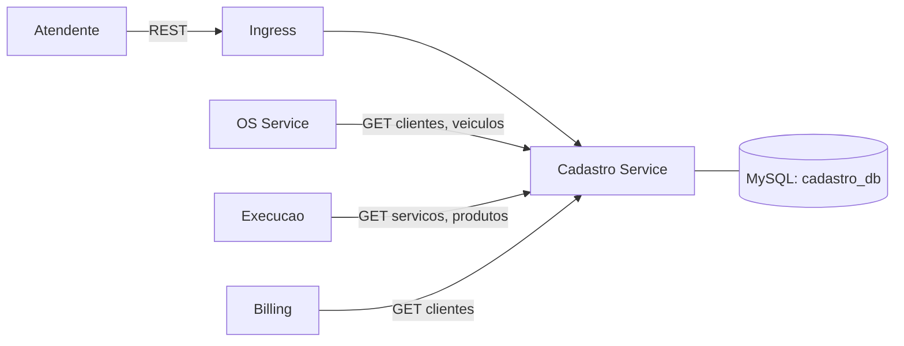

# AutoCenter - Cadastro Service

Microsservico de Cadastro do AutoCenter (FIAP Tech Challenge, Fase 4): **clientes, veiculos, servicos e produtos
(com estoque)**. Foi extraido dos modulos `cliente`, `veiculo`, `servico` e `produto` do monolito, tem MySQL proprio e
atende so REST. Nao participa da Saga. Arquitetura em [`docs/arquitetura.md`](docs/arquitetura.md).



Quem consome:

| Servico | Rota | Para que |
|---|---|---|
| OS Service | `GET /v1/clientes/{id}`, `GET /v1/veiculos/{id}` | So abre OS para cliente `ATIVO` e veiculo existente |
| Execucao | `GET /v1/servicos/{id}`, `GET /v1/produtos/{id}` | Descricao e preco dos itens do diagnostico vem do catalogo |
| Billing | `GET /v1/clientes/{id}` | E-mail e telefone para enviar o orcamento |

Endereco interno no cluster: `http://cadastro-service.autocenter.svc.cluster.local:8097`.

## API

Mesmos caminhos do monolito, entao a collection Postman da Fase 3 continua valendo para estas rotas.

| Recurso | Rotas |
|---|---|
| `/v1/clientes` | `GET` (paginado), `GET /{id}`, `GET /documento/{documento}`, `POST`, `PUT /{id}`, `DELETE /{id}` |
| `/v1/veiculos` | `GET` (paginado), `GET /{id}`, `GET /placa/{placa}`, `POST`, `PUT /{id}`, `DELETE /{id}` |
| `/v1/servicos` | `GET` (paginado), `GET /{id}`, `GET /status/{status}`, `POST`, `PUT /{id}`, `DELETE /{id}` |
| `/v1/produtos` | `GET`, `GET /{id}`, `POST`, `PUT /{id}`, `DELETE /{id}`, `PATCH /{id}/estoque/adicionar`, `PATCH /{id}/estoque/remover`, `GET /estoque/alertas` |

**Diferencas para o monolito:**
- `DELETE` de servico e de produto **inativa** o item (`status=INATIVO` / `ativo=false`). O item continua consultavel,
  entao orcamentos e execucoes antigos nao perdem a referencia.
- `DELETE` de cliente e de veiculo apaga direto. A checagem "em uso por OS" foi removida, porque lia a tabela de OS, que
  agora pertence ao OS Service. Nenhum servico le o banco de outro.
- A resposta de cliente traz `status` (`ATIVO`, `INATIVO`, `BLOQUEADO`).
- Todos os erros usam o mesmo formato: `{"timestamp", "status", "erro", "mensagem", "caminho"}`.

**Seguranca:** JWT HS256 com o mesmo segredo dos outros servicos (`SISTEMA_SEGURANCA_CHAVE_SECRETA`). Token interno
acessa tudo; token de cliente (`tipo=cliente`) recebe 403; sem token, 401. Swagger e actuator sao publicos.

**Dados de exemplo** (migrations Flyway): 4 clientes (o id 1 esta `ATIVO`; o CPF `33366699957` esta `INATIVO`), veiculos
(id 1 com placa `ABC1D23`), servicos (id 1 "Troca de Oleo e Filtro", R$ 150,00) e produtos.

## Como rodar

**Testes:** `mvn -B verify` (precisa de Docker: o Testcontainers sobe um MySQL).

**Local com docker-compose.** O segredo JWT nao tem valor padrao:
```bash
export SISTEMA_SEGURANCA_CHAVE_SECRETA="$(openssl rand -hex 32)"
docker compose -f docker/docker-compose.yml up -d mysql   # MySQL na porta 3307
mvn spring-boot:run                                        # porta 8097
# ou tudo em containers:
docker compose -f docker/docker-compose.yml up -d --build
```

**No cluster kind** (infra em `autocenter-k8s-infra`). Todo comando usa `--context`, porque o contexto padrao desta
maquina e um EKS real. O Secret e criado uma vez por cluster, reaproveitando o segredo JWT do OS Service:
```bash
CTX=kind-autocenter   # ou kind-autocenter-qa
JWT=$(kubectl --context $CTX -n autocenter get secret os-service-secrets \
  -o jsonpath='{.data.SISTEMA_SEGURANCA_CHAVE_SECRETA}' | base64 -d)
kubectl --context $CTX -n autocenter create secret generic cadastro-service-secrets \
  --from-literal=MYSQL_ROOT_PASSWORD="$(openssl rand -hex 16)" \
  --from-literal=DB_USERNAME=cadastro \
  --from-literal=DB_PASSWORD="$(openssl rand -hex 16)" \
  --from-literal=SISTEMA_SEGURANCA_CHAVE_SECRETA="$JWT"

./scripts/deploy-kind.sh autocenter local      # build, kind load, apply e rollout
curl -H "Authorization: Bearer $(./scripts/gerar-token.sh)" http://localhost/v1/servicos/1
```
Na homologacao: `./scripts/deploy-kind.sh autocenter-qa local`, token com
`KUBE_CONTEXT=kind-autocenter-qa ./scripts/gerar-token.sh` e Ingress em `http://localhost:18080/`.

**Deploy pelo pipeline** (`ci-cd.yml`, job `deploy`, runner self-hosted): roda depois do build e do Sonar, em push na
`main` ou na `homologacao`, com `scripts/deploy-kind.sh <cluster> <sha>`. O script aborta se o Secret nao existir.

| Branch | Cluster kind | GitHub Environment |
|---|---|---|
| `main` | `autocenter` (`kind-autocenter`) | `producao` |
| `homologacao` | `autocenter-qa` (`kind-autocenter-qa`) | `homologacao` |

O fluxo de branches e o mesmo dos outros repositorios: uma feature branch sai da `homologacao`, entra por PR na
`homologacao` (deploy no `autocenter-qa`) e depois a `homologacao` entra na `main` (deploy no `autocenter`). Passos
manuais do GitHub em [`docs/setup-github.md`](docs/setup-github.md).

## Swagger

O Ingress expoe so as rotas `/v1/...`. Para o Swagger, use port-forward:
```bash
kubectl --context kind-autocenter -n autocenter port-forward svc/cadastro-service 8097:8097
# http://localhost:8097/swagger-ui/index.html      (OpenAPI em /v3/api-docs)
```

## Evidencias de cobertura

Resultado de `mvn -B verify` (BUILD SUCCESS, gate de 80% de linhas do JaCoCo atendido), medido em
`target/site/jacoco/jacoco.xml`, com unitarios e integracao no mesmo relatorio:

| Metrica | Cobertas / total | % |
|---|---|---|
| Linhas | 1385 / 1462 | 94,7 |
| Instrucoes | 4947 / 5354 | 92,4 |
| Branches | 229 / 343 | 66,8 |
| Metodos | 299 / 330 | 90,6 |

Testes: 88 unitarios (Surefire) e 118 de integracao (Failsafe, com Testcontainers MySQL), todos passando. Ficam fora da
medicao `CadastroServiceApplication`, os DTOs e as entidades JPA.

## Fluxo completo validado (homologacao, `autocenter-qa`, 2026-11-16)

Os quatro servicos rodando no `kind-autocenter-qa` com o mesmo segredo JWT e um token interno de
`KUBE_CONTEXT=kind-autocenter-qa scripts/gerar-token.sh`. Execucao e Billing acessados por port-forward
(`18098` e `18099`); OS e Cadastro pelo Ingress (`localhost:18080`).

| Passo | Chamada | Resultado |
|---|---|---|
| Cliente inexistente | `POST /v1/ordem-servicos` com `clienteId` 9999 | 404 `Cliente nao encontrado: 9999` |
| Cliente inativo | idem com `clienteId` 3 (`INATIVO` no seed) | 404 |
| Veiculo inexistente | idem com `veiculoId` inexistente | 404 |
| Abrir OS | cliente 1, veiculo 1 | 201, OS 1 `ABERTA` |
| Item fora do catalogo | `POST /execucoes/1/diagnostico` `{"servicos":[{"servicoId":999}]}` | 422 `Servico 999 nao encontrado no catalogo` |
| Diagnostico so com IDs | `{"servicos":[{"servicoId":1}],"produtos":[{"produtoId":1,"quantidade":2}]}` | 200; itens com "Troca de Oleo e Filtro" R$ 150,00 e "Filtro de Oleo" 2 x R$ 45,90, vindos do catalogo |
| Orcamento | `GET /v1/orcamentos/os/1` no Billing | `valorTotal` 241.80 (150,00 + 2 x 45,90); OS em `AGUARDANDO_APROVACAO` |
| Envio | `POST /v1/orcamentos/1/enviar-cliente` `EMAIL` / `WHATSAPP` | "enviado via EMAIL para joao.silva@email.com" / "via WHATSAPP para 11987654321" |
| Cadastro fora do ar | `scale deploy/cadastro-service --replicas=0`, abrir OS e concluir diagnostico | 503 `cadastro_indisponivel` nos dois; nenhuma OS gravada |

**Pre-requisito:** os quatro servicos precisam do mesmo `SISTEMA_SEGURANCA_CHAVE_SECRETA`, porque cada um repassa o
token do usuario ao Cadastro. Para conferir sem expor o valor:
```bash
for x in "autocenter os-service-secrets" "autocenter cadastro-service-secrets" \
         "auto-center-execucao execucao-secrets" "auto-center-billing billing-secrets"; do
  set -- $x; printf '%-40s ' "$1/$2"
  kubectl --context kind-autocenter-qa -n $1 get secret $2 \
    -o jsonpath='{.data.SISTEMA_SEGURANCA_CHAVE_SECRETA}' | base64 -d | sha256sum | cut -c1-12
done
```

## O que ainda nao foi validado

- O pipeline no GitHub: o repositorio ainda nao foi criado na organizacao e o `ci-cd.yml` nunca rodou.
- O fluxo completo no `kind-autocenter` (producao): la o `execucao-secrets` tem o JWT vazio e o `os-service-secrets`
  usa outro valor; alinhar os segredos (e o secret do environment `producao` no GitHub da Execucao e do Billing) antes.
- Entrega de traces e metricas ao Datadog: o tracer esta na imagem, mas `DD_TRACE_ENABLED=false`.
- A Lambda de autenticacao por CPF da Fase 3 continua lendo `clientes` no RDS da AWS. Ela nao roda no kind e nao foi
  ligada a este servico.
